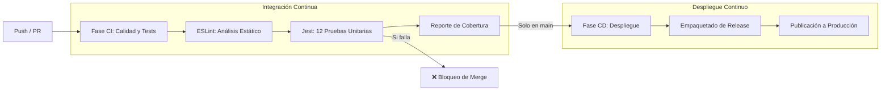

# 🏥 MediSync - Plataforma Web con Pipeline CI/CD Automatizado


-success?logo=jest)


> **Proyecto de Posgrado / Maestría:** Implementación de flujo de Integración Continua y Despliegue Continuo (CI/CD) para una aplicación web moderna, con demostración en vivo de fallos de código y estrategia colaborativa en GitHub.

---

## 📌 1. Giro de Negocio

**MediSync** es una plataforma SaaS (*Software as a Service*) orientada al sector salud ambulatorio (policlínicos, consultorios médicos independientes y centros odontológicos).

* **El Problema:** El sector salud sufre hasta un **28% de ausentismo de pacientes** debido a sistemas de agendamiento obsoletos, citas duplicadas y saturación en secretaría.
* **Nuestra Solución:** Un sistema web inteligente de agendamiento de consultas con validación en tiempo real:
  * Evita solapamiento de horarios entre médicos y pacientes.
  * Valida reglas estrictas de fecha, especialidad y estado de consulta.
  * Proporciona un dashboard con métricas de ocupación en tiempo real.
* **Modelo de Negocio:** Suscripción mensual por profesional de salud activo (Plan Free hasta 2 médicos, Plan Pro para clínicas).

---

## 🏗️ 2. Arquitectura de la Solución

```
├── .github/
│   └── workflows/
│       └── ci-cd.yml              # Pipeline automatizado de GitHub Actions
├── src/
│   ├── public/
│   │   └── index.html             # Frontend interactivo con Tailwind CSS y Dashboard
│   ├── services/
│   │   └── appointmentService.js  # Lógica de negocio y reglas de citas médicas
│   └── server.js                  # API REST construida con Express
├── tests/
│   ├── appointmentService.test.js # Pruebas unitarias de reglas de negocio
│   └── api.test.js                # Pruebas de integración de endpoints REST
├── DEMO_ERROR_GUIDE.md            # Guía para la demostración en vivo de error en el pipeline
├── PRESENTATION_GUIDE.md          # Guión minuto a minuto para la exposición de 20-30 min
├── TEAM_COLLABORATION_GUIDE.md    # Guía de ramas y trabajo colaborativo del equipo
├── .eslintrc.json                 # Configuración del Linter de calidad de código
└── package.json                   # Dependencias y scripts del proyecto
```

---

## ⚙️ 3. Pipeline de CI/CD (`.github/workflows/ci-cd.yml`)

El pipeline se ejecuta automáticamente en cada `push` y `pull_request`:



### Puertas de Calidad (Quality Gates):
1. **Linter (ESLint):** Analiza sintaxis, variables no utilizadas y consistencia de estilo.
2. **Pruebas Automatizadas (Jest):** Ejecuta 12 pruebas de negocio con cobertura $\ge 90\%$.
3. **Artifacts:** Guarda el reporte de cobertura en GitHub para auditoría.
4. **Despliegue Continuo (CD):** Solo si la fase CI pasa en verde y el commit es a la rama `main`.

---

## 🚀 4. Instalación y Ejecución Local

### Prerrequisitos
* Node.js $\ge 18.0$
* npm $\ge 9.0$

### Pasos:
```bash
# 1. Instalar dependencias
npm install

# 2. Ejecutar análisis estático (Linter)
npm run lint

# 3. Ejecutar pruebas unitarias y ver cobertura
npm run test:coverage

# 4. Iniciar la aplicación web en modo desarrollo
npm start
```
Abre tu navegador en: **`http://localhost:3000`**

---

## 🔴 5. Demostración de Error de Código en Vivo

Para realizar la demostración requerida por el docente (donde se rompe el código a propósito para ver fallar el pipeline y luego se corrige):
👉 **Consulta la guía completa en [DEMO_ERROR_GUIDE.md](file:///c:/Users/joell/Desktop/maestrai%20classe/DEMO_ERROR_GUIDE.md)**.

---

## 👥 6. Colaboración de Todo el Equipo

Para garantizar que todos los participantes tengan commits, ramas y Pull Requests registrados en GitHub:
👉 **Consulta la guía de trabajo en equipo en [TEAM_COLLABORATION_GUIDE.md](file:///c:/Users/joell/Desktop/maestrai%20classe/TEAM_COLLABORATION_GUIDE.md)**.

---

## 🎤 7. Guión de Exposición (20 a 30 Minutos)

Para preparar la presentación oral minuto a minuto con roles asignados y respuestas a preguntas del jurado:
👉 **Consulta el guión en [PRESENTATION_GUIDE.md](file:///c:/Users/joell/Desktop/maestrai%20classe/PRESENTATION_GUIDE.md)**.
